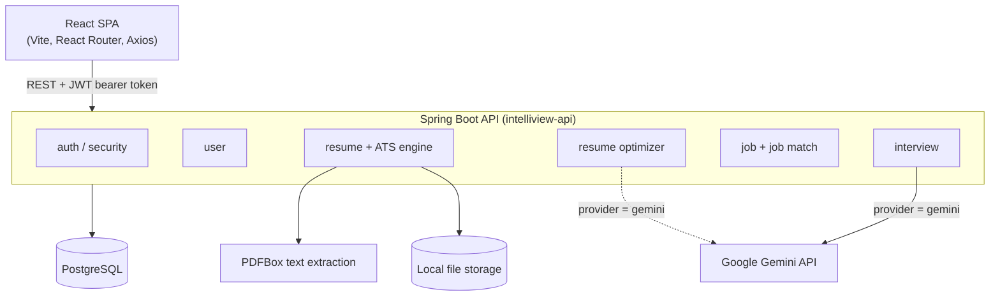
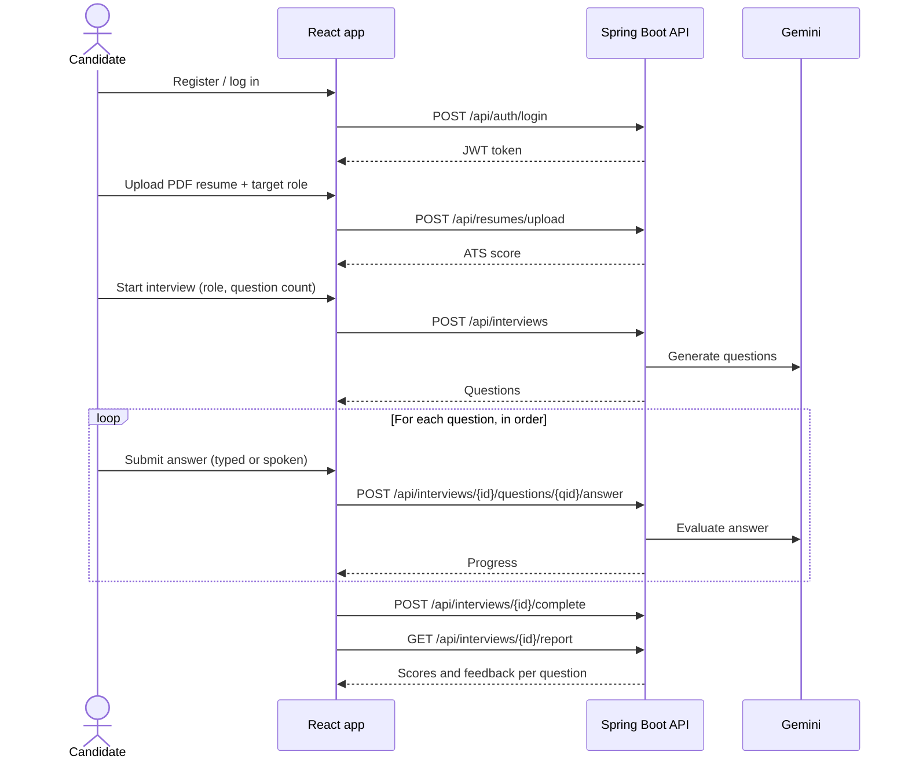
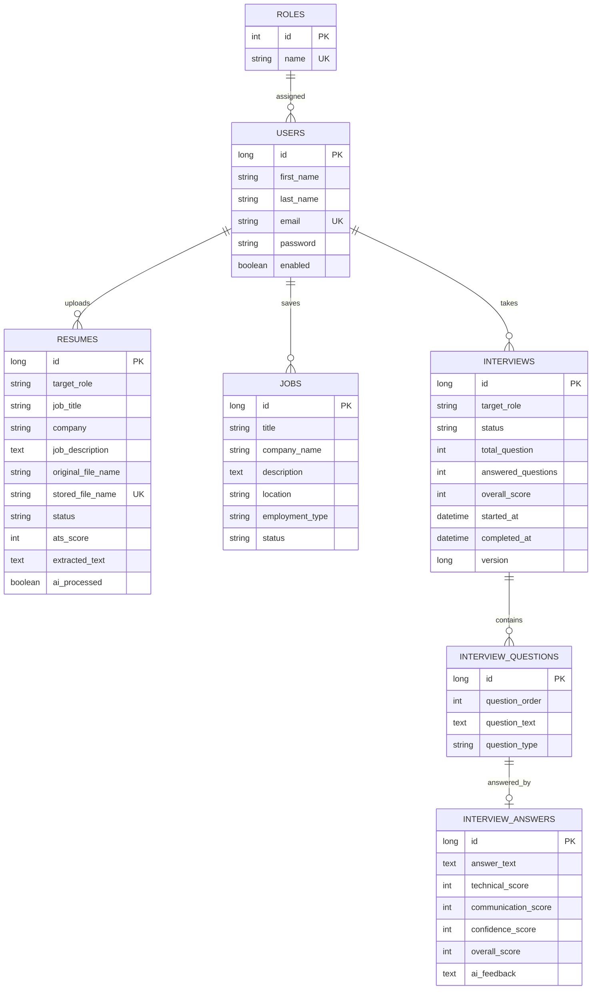

<div align="center">

# IntelliView AI

**An AI-powered interview preparation platform: ATS resume analysis, job matching, and AI-led mock interviews with scored feedback.**


</div>

> **Project status:** in active development. This README describes what is implemented in the repository today. Items that are not implemented are listed under [Known Issues](#known-issues) and [Roadmap](#roadmap).

---

## Table of Contents

1. [Overview](#overview)
2. [Key Features](#key-features)
3. [Screenshots](#screenshots)
4. [Technology Stack](#technology-stack)
5. [System Architecture](#system-architecture)
6. [Project Structure](#project-structure)
7. [Application Workflow](#application-workflow)
8. [Database Design](#database-design)
9. [Prerequisites](#prerequisites)
10. [Installation and Setup](#installation-and-setup)
11. [Environment Variables](#environment-variables)
12. [Running the Application](#running-the-application)
13. [API Documentation](#api-documentation)
14. [AI Integration](#ai-integration)
15. [Authentication and Security](#authentication-and-security)
16. [Testing](#testing)
17. [Docker and CI](#docker-and-ci)
18. [Known Issues](#known-issues)
19. [Troubleshooting](#troubleshooting)
20. [Roadmap](#roadmap)
21. [Contributing](#contributing)
22. [License](#license)
23. [Author](#author)

---

## Overview

IntelliView AI helps candidates prepare for job interviews in three connected steps:

1. **Check the resume.** Upload a PDF resume for a target role and get a rule-based ATS score with matched and missing skills, education, experience, projects, and certifications.
2. **Find the gaps.** Save job postings and see how well a resume matches each one.
3. **Practice.** Run a mock interview for a chosen role. An LLM generates the questions, scores each answer, and produces a per-question report.

**Problem addressed:** candidates often do not know how their resume reads to an ATS, how well it fits a specific job, or how their interview answers would be judged. IntelliView AI puts these three checks in one place.

**Target users:** job seekers practicing for technical and professional roles.

## Key Features

### Implemented

- **Authentication.** Registration, login, and password change using JWT bearer tokens.
- **User profile.** View and update first and last name.
- **Resume upload and ATS analysis.** PDF upload (validated by extension, content type, `%PDF-` signature, and size), text extraction with Apache PDFBox, and rule-based scoring for skills, experience, education, projects, certifications, email, and phone.
- **Role-specific ATS profiles.** Scoring is driven by a JSON profile per target role. An optional job description narrows the required skills.
- **Resume optimizer.** Produces an overall assessment, key weaknesses, and per-section recommendations. Uses a deterministic placeholder provider by default, or Google Gemini when configured.
- **Job tracking and matching.** Create, list, update, and delete jobs. Compute a keyword-overlap match score between a job and an uploaded resume.
- **AI mock interviews.** Choose a role and 1 to 20 questions. Gemini generates the questions and scores each answer on technical, communication, and confidence (0 to 100) with written feedback. Answers must be submitted in order.
- **Interview report.** Per-question scores and feedback, plus an overall score calculated in code as the average of per-answer overall scores.
- **Voice and camera in the interview UI.** Browser Web Speech API for speech-to-text and text-to-speech, and camera preview via `getUserMedia`.
- **Web app.** Landing page, dashboard, resume, jobs, job details, interview setup, interview session, interview report, reports, and profile pages, with light and dark theme support.

### Not implemented

Adaptive difficulty, resume-based or job-description-based interview questions, coding questions, recruiter and admin features, refresh tokens, and rate limiting. See the [Roadmap](#roadmap).

## Screenshots

Add screenshots to a `docs/screenshots/` folder and update the paths below.

| Screen | Preview |
|---|---|
| Landing page | `` |
| Dashboard | `` |
| Resume ATS analysis | `` |
| Mock interview | `` |
| Interview report | `` |

## Technology Stack

| Layer | Technologies |
|---|---|
| **Frontend** | React 19, Vite 8, React Router 7, Axios, Framer Motion, Three.js with React Three Fiber and Drei, Lenis, Lucide React. JavaScript (JSX), ESLint |
| **Backend** | Java 17, Spring Boot 4.1.1, Spring Web, Spring Security, Spring Data JPA (Hibernate), Bean Validation, Lombok, Maven (wrapper included) |
| **Authentication** | JWT (jjwt 0.12.6, HS256), BCrypt password hashing |
| **Database** | PostgreSQL (schema generated by Hibernate `ddl-auto`) |
| **Documents** | Apache PDFBox 3.0.5 for PDF text extraction; local disk storage for uploaded files |
| **AI** | Google Gemini over REST (Spring `RestClient`) with JSON-schema structured output |
| **DevOps** | Docker (multi-stage backend image), GitHub Actions (build and push image to Docker Hub) |

## System Architecture

A single Spring Boot application exposes a REST API to a React single-page app. Code is organized by feature package.



| Package (`com.vinay.intelliview`) | Responsibility |
|---|---|
| `auth`, `security` | Registration, login, JWT creation and validation, Spring Security and CORS configuration |
| `user` | User and role entities, profile endpoints |
| `resume` | Resume upload, PDF parsing, ATS rules and profiles, ATS reports |
| `resume.ats.optimizer` | Resume optimization with a pluggable provider (placeholder or Gemini) |
| `job` | Job CRUD and resume-to-job keyword matching |
| `interview` | Interview sessions, questions, answers, scoring, report, and the Gemini provider |
| `storage` | File storage abstraction and local-disk implementation |
| `exception`, `common` | Global exception handler, `ApiResponse` wrapper, error codes, auditing base entity |

## Project Structure

```text
intelliview/
├── .github/workflows/
│   └── deploy.yml                  # Build jar, build and push Docker image
├── Backend/
│   └── intelliview-api/
│       ├── src/main/java/com/vinay/intelliview/
│       │   ├── auth/               # controller, dto, service
│       │   ├── user/               # entity, repository, service, controller, dto
│       │   ├── resume/             # upload, ATS engine (rules, profiles), optimizer
│       │   ├── job/                # job CRUD and job matching
│       │   ├── interview/          # entities, AI provider, service, controller, dto
│       │   ├── security/           # SecurityConfig, CorsConfig, jwt/, userdetails/
│       │   ├── storage/            # FileStorageService, LocalFileStorageService
│       │   ├── exception/          # GlobalExceptionHandler and custom exceptions
│       │   ├── config/             # Jackson, JPA auditing, role initializer
│       │   └── common/             # BaseEntity, ApiResponse, ErrorCode
│       ├── src/main/resources/application.yaml
│       ├── src/test/java/...       # context-load test
│       ├── Dockerfile
│       ├── mvnw, mvnw.cmd
│       └── pom.xml
├── Frontend/
│   └── intelliview-web/
│       ├── src/
│       │   ├── pages/              # landing, auth, app/ (dashboard, resume, jobs, interview, ...)
│       │   ├── components/         # landing, dashboard, resume, jobs, interview, layout, common
│       │   ├── services/           # Axios service modules per feature
│       │   ├── hooks/              # speech recognition, text-to-speech, interview media
│       │   ├── context/            # AuthContext, ThemeContext
│       │   └── lib/api.js          # Axios instance with token interceptor
│       ├── package.json
│       └── vite.config.js
└── README.md
```

## Application Workflow



## Database Design

Tables are created by Hibernate (`spring.jpa.hibernate.ddl-auto`, default `update`). There are no migration files in the repository. Entities extending `BaseEntity` also carry `created_at` and `updated_at` columns.



Enum values: `ResumeStatus` (ACTIVE, PROCESSING, ARCHIVED, DELETED), `JobStatus` (DRAFT, ACTIVE, CLOSED), `InterviewStatus` (CREATED, IN_PROGRESS, COMPLETED, REPORT_GENERATED).

## Prerequisites

- Git
- JDK 17
- Node.js and npm (the frontend was built successfully with Node 22; the repository does not pin a version)
- PostgreSQL
- A Google Gemini API key (required for interviews, see [Known Issues](#known-issues))
- Docker (optional, for the backend image)

Maven does not need to be installed; the project includes the Maven wrapper.

## Installation and Setup

```bash
git clone https://github.com/vinaybarfa/intelliview.git
cd intelliview
```

### 1. Create the database

```sql
CREATE DATABASE intelliview;
CREATE USER intelliview_user WITH PASSWORD '<choose-a-password>';
GRANT ALL PRIVILEGES ON DATABASE intelliview TO intelliview_user;
```

On PostgreSQL 15 and later you may also need to grant schema privileges:

```sql
\c intelliview
GRANT ALL ON SCHEMA public TO intelliview_user;
```

### 2. Configure environment variables

The backend reads configuration from environment variables (see the next section). Export them in your shell or set them in your IDE run configuration. Never commit real values.

### 3. Seed the roles (required for now)

Registration looks up the role `ROLE_USER`. The `RoleInitializer` class in the repository is not registered as a Spring bean, so roles are not created automatically (see [Known Issues](#known-issues)). After the first backend start has created the tables, run:

```sql
INSERT INTO roles (name) VALUES ('ROLE_USER'), ('ROLE_ADMIN');
```

### 4. Provide ATS role profiles (required for resume upload)

Resume upload validates the target role against JSON files at `Backend/intelliview-api/src/main/resources/ats/profiles/<role-id>.json`. These files are not present in the repository (see [Known Issues](#known-issues)). The frontend offers these role IDs: `business-analyst`, `data-analyst`, `data-scientist`, `devops-engineer`, `frontend-developer`, `fullstack-developer`, `java-developer`, `machine-learning-engineer`, `product-manager`, `python-developer`, `react-developer`, `software-engineer`, `ui-ux-designer`.

Each profile maps to the `AtsProfile` class (fields include `id`, `displayName`, `requiredSkills`, `optionalSkills`, `frameworks`, `libraries`, `tools`, `databases`, `cloudPlatforms`, `programmingLanguages`, `softSkills`, `requiredSections`, `preferredSections`, `educationKeywords`, `experienceKeywords`, `projectKeywords`, `certificationKeywords`, `atsKeywords`, `minimumScore`).

## Environment Variables

Backend variables, taken from `application.yaml`:

| Variable | Required | Default | Description |
|---|---|---|---|
| `DB_URL` | Yes | none | JDBC URL, for example `jdbc:postgresql://localhost:5432/intelliview` |
| `DB_USERNAME` | Yes | none | Database user |
| `DB_PASSWORD` | Yes | none | Database password |
| `JWT_SECRET` | Yes | none | HS256 signing secret, at least 32 bytes (the app fails to start otherwise) |
| `INTELLIVIEW_AI_PROVIDER` | See note | `placeholder` | `gemini` or `placeholder`. Set to `gemini` for interviews to work |
| `GEMINI_API_KEY` | When using Gemini | empty | Google Gemini API key |
| `GEMINI_MODEL` | No | `gemini-3.5-flash` | Model name sent to the API |
| `GEMINI_BASE_URL` | No | `https://generativelanguage.googleapis.com/v1beta` | API base URL |
| `GEMINI_CONNECT_TIMEOUT` | No | `5s` | HTTP connect timeout |
| `GEMINI_REQUEST_TIMEOUT` | No | `60s` | HTTP read timeout |
| `CORS_ALLOWED_ORIGINS` | No | `http://localhost:5173` | Comma-separated explicit origins (wildcards are rejected) |
| `JPA_DDL_AUTO` | No | `update` | Hibernate schema mode |
| `JPA_SHOW_SQL` | No | `false` | Log SQL statements |
| `JPA_FORMAT_SQL` | No | `false` | Pretty-print SQL logs |

Frontend variable:

| Variable | Default | Description |
|---|---|---|
| `VITE_API_BASE_URL` | `http://localhost:8080` | Base URL of the backend API |

Example shell setup (macOS / Linux). Replace every placeholder:

```bash
export DB_URL="jdbc:postgresql://localhost:5432/intelliview"
export DB_USERNAME="intelliview_user"
export DB_PASSWORD="<your-db-password>"
export JWT_SECRET="<random-string-of-at-least-32-characters>"
export INTELLIVIEW_AI_PROVIDER="gemini"
export GEMINI_API_KEY="<your-gemini-api-key>"
```

On Windows PowerShell use `$env:DB_URL = "..."` for each variable.

## Running the Application

### Backend

```bash
cd Backend/intelliview-api
./mvnw spring-boot:run          # Windows: mvnw.cmd spring-boot:run
```

The API listens on port `8080` (set in `application.yaml`).

### Frontend

```bash
cd Frontend/intelliview-web
npm install
npm run dev
```

Vite serves the app on `http://localhost:5173` by default, which matches the backend's default CORS origin. To point the app at a different backend, create `Frontend/intelliview-web/.env.local`:

```dotenv
VITE_API_BASE_URL=http://localhost:8080
```

Other frontend scripts: `npm run build`, `npm run preview`, `npm run lint`.

## API Documentation

All endpoints are under `/api`. Only `/api/auth/**` is public; every other endpoint requires `Authorization: Bearer <token>`.

### Response format

Most endpoints return the `ApiResponse` wrapper:

```json
{
  "success": true,
  "message": "Login successful",
  "data": { },
  "timestamp": "2026-01-01T10:00:00"
}
```

Errors set `success` to `false` and include an `errorCode` (`RESOURCE_NOT_FOUND`, `DUPLICATE_RESOURCE`, `UNAUTHORIZED`, `VALIDATION_ERROR`, `AI_PROVIDER_ERROR`, `INTERNAL_SERVER_ERROR`). Typical HTTP statuses: 400 validation, 401 unauthorized, 404 not found, 409 conflict, and 502 or 503 for AI provider failures.

Exceptions: `POST /api/resumes/upload` returns the upload result directly (not wrapped), and `DELETE /api/jobs/{jobId}` returns `204 No Content`.

### Endpoints

| Method | Endpoint | Description |
|---|---|---|
| `POST` | `/api/auth/register` | Create an account |
| `POST` | `/api/auth/login` | Log in and receive a JWT |
| `POST` | `/api/auth/change-password` | Change the current user's password |
| `GET` | `/api/users/me` | Email of the authenticated user |
| `GET` | `/api/users/profile` | Get profile |
| `PUT` | `/api/users/profile` | Update first and last name |
| `POST` | `/api/resumes/upload` | Upload a PDF resume (multipart) and get an ATS score |
| `GET` | `/api/resumes` | List the user's resumes |
| `GET` | `/api/resumes/{resumeId}/analysis` | Detailed ATS report |
| `POST` | `/api/resumes/{resumeId}/optimize` | AI or placeholder resume optimization |
| `DELETE` | `/api/resumes/{resumeId}` | Delete a resume and its file |
| `POST` | `/api/jobs` | Create a job |
| `GET` | `/api/jobs` | List the user's jobs |
| `GET` | `/api/jobs/{jobId}` | Get a job |
| `PUT` | `/api/jobs/{jobId}` | Update a job |
| `DELETE` | `/api/jobs/{jobId}` | Delete a job |
| `GET` | `/api/job-matches` | Match every job against every resume, sorted by score |
| `POST` | `/api/jobs/{jobId}/match` | Match one job against a resume (`{"resumeId": 1}`) |
| `GET` | `/api/interviews` | List the user's interviews |
| `POST` | `/api/interviews` | Start an interview and generate questions |
| `POST` | `/api/interviews/{interviewId}/questions/{questionId}/answer` | Submit and evaluate an answer |
| `POST` | `/api/interviews/{interviewId}/complete` | Complete the interview and compute the overall score |
| `GET` | `/api/interviews/{interviewId}/report` | Get the full report (completed interviews only) |

### Examples

**Register**

```http
POST /api/auth/register
Content-Type: application/json

{
  "firstName": "Asha",
  "lastName": "Verma",
  "email": "asha@example.com",
  "password": "<min-8-characters>"
}
```

**Login**

```http
POST /api/auth/login
Content-Type: application/json

{ "email": "asha@example.com", "password": "<your-password>" }
```

```json
{
  "success": true,
  "message": "Login successful",
  "data": {
    "userId": 1,
    "firstName": "Asha",
    "lastName": "Verma",
    "email": "asha@example.com",
    "token": "<jwt>"
  }
}
```

**Upload a resume**

```bash
curl -X POST http://localhost:8080/api/resumes/upload \
  -H "Authorization: Bearer <token>" \
  -F "file=@resume.pdf;type=application/pdf" \
  -F "targetRole=java-developer" \
  -F "jobTitle=Backend Engineer" \
  -F "company=Example Corp"
```

```json
{
  "id": 1,
  "originalFileName": "resume.pdf",
  "targetRole": "java-developer",
  "jobTitle": "Backend Engineer",
  "company": "Example Corp",
  "atsScore": 72,
  "message": "Resume upload and analyzed successfully"
}
```

`targetRole` is required. `jobTitle`, `company`, and `jobDescription` are optional.

**Start an interview**

```http
POST /api/interviews
Authorization: Bearer <token>
Content-Type: application/json

{ "targetRole": "Java Backend Developer", "questionCount": 5 }
```

Response `data` contains `interviewId`, `targetRole`, `status`, `totalQuestions`, `answeredQuestions`, `startedAt`, and `questions` (each with `questionId`, `questionOrder`, `questionText`, `questionType`).

**Submit an answer**

```http
POST /api/interviews/1/questions/10/answer
Authorization: Bearer <token>
Content-Type: application/json

{ "answerText": "A HashMap stores entries in buckets using the key's hash ..." }
```

Response `data`: `interviewId`, `status`, `answeredQuestions`, `totalQuestions`, `overallScore` (null until the interview is completed).

**Create a job**

```http
POST /api/jobs
Authorization: Bearer <token>
Content-Type: application/json

{
  "title": "Backend Engineer",
  "companyName": "Example Corp",
  "description": "Java, Spring Boot, PostgreSQL ...",
  "location": "Remote",
  "employmentType": "Full-time",
  "status": "ACTIVE"
}
```

## AI Integration

- **Provider.** Google Gemini, called over REST with Spring's `RestClient` (`POST {base-url}/interactions`, API key sent in the `x-goog-api-key` header). The model, base URL, and timeouts are configurable. There is no LLM framework dependency.
- **Provider switch.** `INTELLIVIEW_AI_PROVIDER` selects `gemini` or `placeholder` through `@ConditionalOnProperty`. The resume optimizer has both implementations. The interview provider currently has only the Gemini implementation.
- **Question generation.** `GeminiInterviewAIProvider.generateQuestions` asks for exactly *N* distinct technical questions for the target role. Questions are generated from the role name only, and every question is stored with type `GENERAL`.
- **Answer evaluation.** Each answer is sent with the role and question. The model returns `technicalScore`, `communicationScore`, `confidenceScore`, `overallScore` (integers 0 to 100) and `feedback`.
- **Structured output.** Requests include a JSON schema. Responses are validated strictly (field presence, integer range, question count), and invalid output returns a `502` with `AI_PROVIDER_ERROR`. No automatic retry is implemented.
- **Scoring in code.** The final interview score is the rounded average of per-answer `overallScore` values, computed by `InterviewService`, not by the model.
- **Interview integrity.** Answers must be submitted in question order, once per question. The `Interview` entity uses optimistic locking (`@Version`).
- **Resume optimizer.** Takes a fresh ATS analysis and returns an assessment, key weaknesses, priority recommendations, and per-section recommendations. The placeholder provider generates these deterministically from the ATS result with no external call.

### ATS scoring engine

- Rule-based (`SkillsRule`, `ExperienceRule`, `EducationRule`, `ProjectRule`, `CertificationRule`, `EmailRule`, `PhoneRule`), driven by the role's JSON profile.
- Category score = matched items / (matched + missing) x 100. Overall score is the average of the categories that had items to assess.
- Category status: `GOOD` at 80 or above, `AVERAGE` at 50 or above, otherwise `NEEDS_IMPROVEMENT`.
- If a job description is supplied, profile skills that appear in it become the required skills.

### Job matching

Keyword overlap: the job's title, description, employment type, and location are compared with the resume's target role, job title, job description, and extracted text. Score = matched keywords / job keywords x 100.

## Authentication and Security

- **JWT bearer tokens.** HS256, 24-hour expiry, signed with `JWT_SECRET` (minimum 32 bytes enforced at startup). The frontend stores the token in `localStorage` and attaches it with an Axios interceptor; a 401 response clears it.
- **Passwords** are hashed with BCrypt.
- **Stateless sessions**, CSRF disabled (token-based API), HTTP Basic disabled.
- **CORS** allows only the explicit origins in `CORS_ALLOWED_ORIGINS`; wildcard values stop the app from starting.
- **Authorization.** All routes except `/api/auth/**` require authentication. Resumes, jobs, and interviews are looked up by owner (`findByIdAndUser`), so users cannot read each other's data. Roles `ROLE_USER` and `ROLE_ADMIN` exist, but no endpoint is restricted by role yet.
- **Upload validation.** PDF only, 10 MB application limit, `%PDF-` signature check, generated UUID file names, and path-traversal protection in the storage service.
- **Validation and errors.** Bean Validation on request DTOs and a central `@RestControllerAdvice` handler.
- **Secrets** are read from environment variables. `.env` files are listed in the backend `.gitignore`.
- **Not implemented:** refresh tokens, token revocation, rate limiting, audit logging.

## Testing

```bash
cd Backend/intelliview-api
./mvnw test
```

The repository contains one test, `IntelliviewApiApplicationTests.contextLoads`, a `@SpringBootTest`. It starts the full application context, so it needs the database and `JWT_SECRET` variables to be set and a reachable PostgreSQL instance. There are no unit or integration tests for the features yet.

Frontend: there is no test script. `npm run lint` and `npm run build` are available (see [Known Issues](#known-issues) for their current state).

## Docker and CI

### Backend image

`Backend/intelliview-api/Dockerfile` is a multi-stage build (Maven 3.9 with Temurin 17, then `eclipse-temurin:17-jre`) that packages the jar with tests skipped and exposes port 8080.

```bash
cd Backend/intelliview-api
docker build -t intelliview-api .
docker run -p 8080:8080 \
  -e DB_URL="jdbc:postgresql://<host>:5432/intelliview" \
  -e DB_USERNAME="<db-user>" \
  -e DB_PASSWORD="<db-password>" \
  -e JWT_SECRET="<at-least-32-characters>" \
  -e INTELLIVIEW_AI_PROVIDER="gemini" \
  -e GEMINI_API_KEY="<your-gemini-api-key>" \
  -e CORS_ALLOWED_ORIGINS="http://localhost:5173" \
  intelliview-api
```

Use a database host the container can reach (for example `host.docker.internal` on Docker Desktop). Uploaded resumes are written inside the container (`upload/resume`), so mount a volume if they must survive restarts. There is no Docker Compose file and no frontend image.

### GitHub Actions

`.github/workflows/deploy.yml` runs on every push to `main`: it builds the backend jar with Java 17 (tests skipped), logs in to Docker Hub, and pushes `<DOCKER_USERNAME>/intelliview:latest`. It requires the repository secrets `DOCKER_USERNAME` and `DOCKER_PASSWORD`. An SSH deployment step is present but commented out. The workflow does not run tests or build the frontend.

## Known Issues

Found while reviewing the repository. Fix these and then remove or update this section.

1. **Frontend build fails on case-sensitive systems (Linux, CI, Docker).** `src/App.jsx` imports `./pages/app/Interview/InterviewPage`, but the folder is named `interview`. Change the import path to lowercase `interview`. With that change alone, `npm run build` succeeded in a test.
2. **Roles are not seeded.** `config/RoleInitializer.java` has no `@Component`, so `ROLE_USER` is never created and registration fails with "Default role ROLE_USER not found". Add `@Component` to the class, or insert the roles manually (see setup step 3).
3. **ATS profile files are missing.** `resources/ats/profiles/*.json` is not in the repository, so no target role validates and resume upload returns "Target role is invalid."
4. **Interviews require the Gemini provider.** `InterviewService` depends on `InterviewAIProvider`, and the only implementation is conditional on `intelliview.ai.provider=gemini`. With the default (`placeholder`) there is no bean for it, so the application is expected to fail to start. Set `INTELLIVIEW_AI_PROVIDER=gemini`, or add a placeholder implementation. This was concluded from reading the code; the backend was not run during this review.
5. **Frontend lint reports errors.** `npm run lint` currently reports undefined identifiers in at least one file (for example `interviewService` and `LoadingScreen`).
6. **Upload size limit.** The code allows 10 MB, but `spring.servlet.multipart.max-file-size` is not configured, so Spring Boot's default (1 MB) applies.
7. **Gemini defaults are unverified.** The default model name (`gemini-3.5-flash`) and the `/interactions` endpoint path are taken from the code. Confirm them against Google's current API documentation.
8. **File name with a hidden character.** `components/interview/` contains a file whose name begins with an invisible Unicode character (`‎ScoreBreakdown.jsx`). Rename it to avoid problems on some systems.
9. **Local storage path.** Files are saved under `upload/resume` relative to the working directory, while the database column stores `uploads/resumes/<name>`.

## Troubleshooting

| Problem | Likely cause | Fix |
|---|---|---|
| `Could not resolve placeholder 'DB_URL'` (or `JWT_SECRET`) | Required environment variable not set | Export the variables before starting the backend |
| `JWT_SECRET must be at least 32 bytes for HS256` | Secret too short | Use a longer random secret |
| `cors.allowed-origins must contain explicit origins` | Empty value or `*` | Set `CORS_ALLOWED_ORIGINS` to explicit origins |
| Registration fails with "Default role ROLE_USER not found" | Roles table empty | See [Known Issues](#known-issues) item 2 |
| Resume upload returns "Target role is invalid." | ATS profile JSON missing, or unsupported role ID | See [Known Issues](#known-issues) item 3 |
| "Resume file must be a PDF." | Wrong extension, content type, or file signature | Upload a real PDF |
| Large PDF rejected | Default multipart limit | See [Known Issues](#known-issues) item 6 |
| `Gemini AI provider is not configured.` (503) | `GEMINI_API_KEY` empty | Set the key |
| `Gemini AI provider returned an unsuccessful response.` (502) | Invalid key, quota, or wrong model name | Check the key, quota, and `GEMINI_MODEL` |
| `Gemini AI provider returned an invalid structured response.` (502) | Model output did not match the schema | Retry the request |
| `Module not found` for `Interview/InterviewPage` during build | Import path case | See [Known Issues](#known-issues) item 1 |
| Browser shows CORS errors | Frontend origin not allowed | Add the origin to `CORS_ALLOWED_ORIGINS` |
| Repeated 401 responses | Missing or expired token | Log in again (tokens last 24 hours) |
| Microphone or camera does not work | Browser permission or unsupported Web Speech API | Allow access; use a browser with speech recognition support |

## Roadmap

These are not implemented in the current code.

- [ ] Fix the items under [Known Issues](#known-issues)
- [ ] Add a placeholder interview AI provider so the app runs without an API key
- [ ] Interview questions based on the resume or a job description
- [ ] Adaptive difficulty and question types beyond `GENERAL`
- [ ] Preparation plans and performance analytics across interviews
- [ ] Role-based access, admin and recruiter features
- [ ] Refresh tokens, rate limiting, and AI usage limits
- [ ] Database migrations (for example Flyway) instead of `ddl-auto`
- [ ] Automated unit and integration tests, and tests in CI
- [ ] Docker Compose for the full stack and a frontend image

## Contributing

1. Fork the repository.
2. Create a branch: `git checkout -b feature/<short-description>`
3. Make your changes and run `./mvnw test` (backend) and `npm run build` (frontend).
4. Commit with a clear message and open a pull request describing the change.

For larger changes, please open an issue first to discuss the approach.

## License

No license file is present in the repository. Add a `LICENSE` file (for example MIT or Apache-2.0) and update this section. Until then, all rights are reserved by the author.

## Author

**Vinay**

- GitHub: [@vinaybarfa](https://github.com/vinaybarfa)
- LinkedIn: `<your-linkedin-profile-url>`
